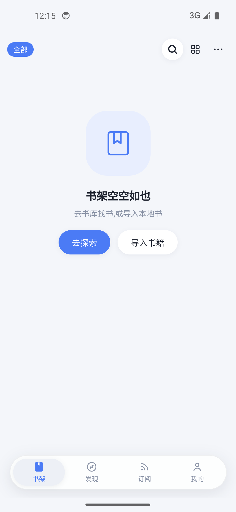
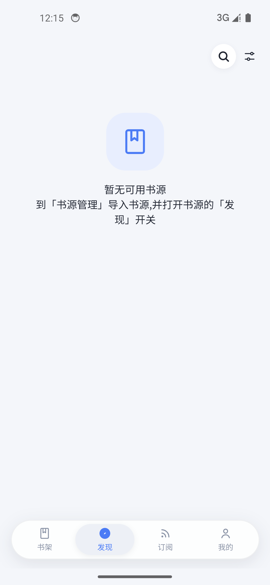
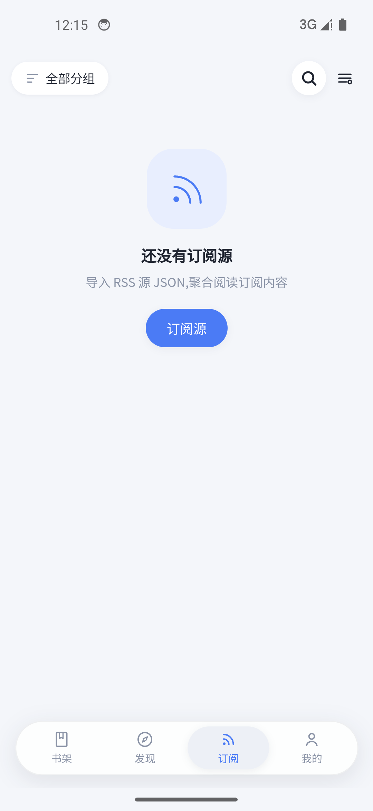
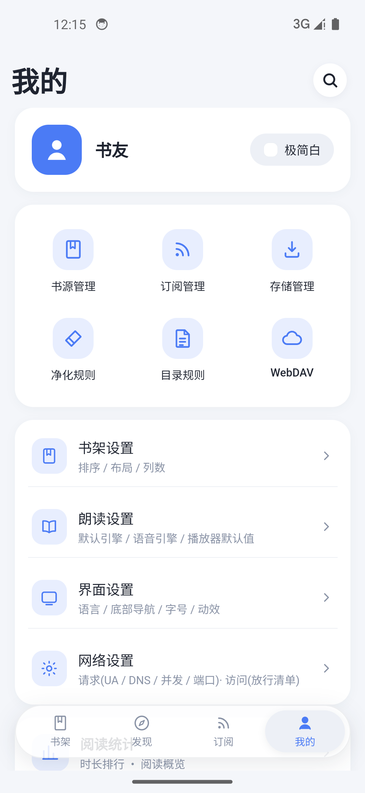
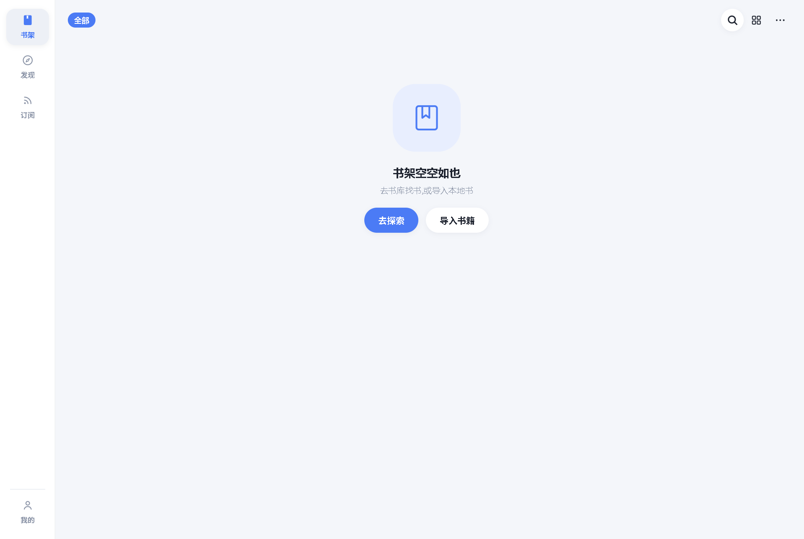
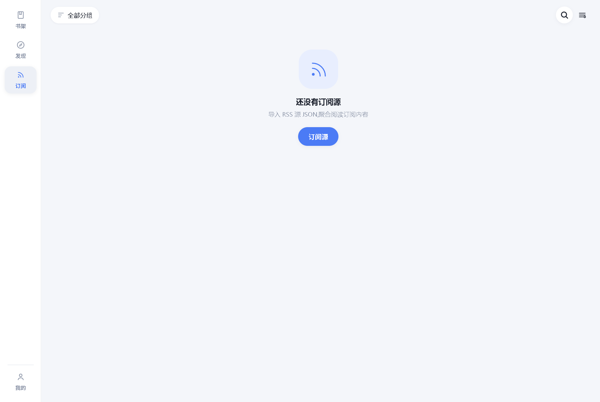

  <h1>书荒阅读</h1>
  
<b>本地优先 · 无广告 · 开源免费</b>的网络小说阅读器

书荒阅读是一款**本地优先**的阅读器:导入书源后,就能在手机上搜索、阅读网络小说,离线缓存整本;
也支持 RSS 订阅、本地电子书导入与听书朗读。书架、阅读进度、设置全部保存在你自己的设备上,
不上传、不追踪。

## 下载

### 安卓(arm64,真机)

**[⬇ 下载最新版 APK](https://github.com/shizheang/shuhuangyuedu/releases/latest/download/app-arm64-release-signed.apk)**

装法:

1. 点上面的链接,下载 `app-arm64-release-signed.apk`;
2. 点开它。系统第一次会拦一下,按提示允许「安装未知应用」即可;
3. 装完直接打开就能用。

> 装好后在「我的 → 关于」里有**检查更新**,会告诉你有没有新版本。

历史版本见 [Releases](https://github.com/shizheang/shuhuangyuedu/releases)。

## 界面

下面都是**刚装好、还没导入任何书源与订阅源**的样子。

  
  
  
  

桌面端(窗口拉宽时左侧导航栏常驻):

  
  

## 这个应用能做什么

- **书源**:导入通用格式的书源规则,搜索 / 详情 / 目录 / 正文全链路解析;一本书在别的源里找不到时,一键换源重找
- **书架**:自建分组与自动分组、批量导入本地书、更新提醒、阅读统计
- **阅读**:主题、字号 / 行距 / 页边距 / 字体、翻页动画都能调;目录、书签、阅读进度;长按选中与笔记批注;护眼与墨水屏模式
- **离线**:整本缓存与批量下载,断网也能看
- **听书**:本机语音、在线朗读,以及自定义的网络朗读引擎
- **订阅**:RSS 与 RSSHub,文章列表与内嵌视频播放
- **本地导入**:TXT / EPUB / HTML / Markdown / MOBI / AZW3;漫画 CBZ / ZIP / 图片型 PDF
- **数据**:全部存在本机;可导出 / 导入备份,也可以接你自己的 WebDAV 做云备份

更细的说明见[源码仓的 README](https://github.com/shizheang/shuhuang#readme)。

## 免责声明

1. 本应用是一款本地阅读工具,自身不提供、不存储、不传播任何书籍内容,也不内置任何书源。
2. 应用内的全部书籍内容均来自用户自行导入的第三方书源规则,由用户从公开网络获取。内容的合法性、准确性与完整性由内容提供方负责,与本应用无关。
3. 用户应确保自己导入和使用的书源规则符合当地法律法规,并尊重著作权人的合法权益。请勿使用本应用获取、传播盗版或侵权内容。
4. 本应用按"现状"提供,不对可用性、无中断或无错误作出任何明示或默示的担保。因使用本应用产生的任何直接或间接损失,开发者不承担责任。
5. 本应用为开源免费软件,不收取任何费用,也不对第三方书源的可用性、安全性或稳定性作任何承诺。
6. 若权利人认为某项内容侵犯其合法权益,请直接向该内容的提供方主张权利。

**请支持正版。**

