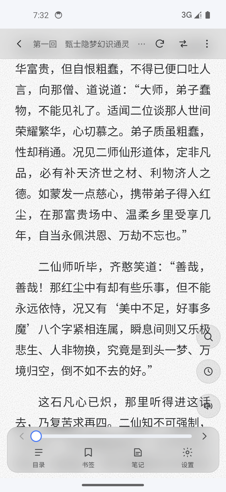
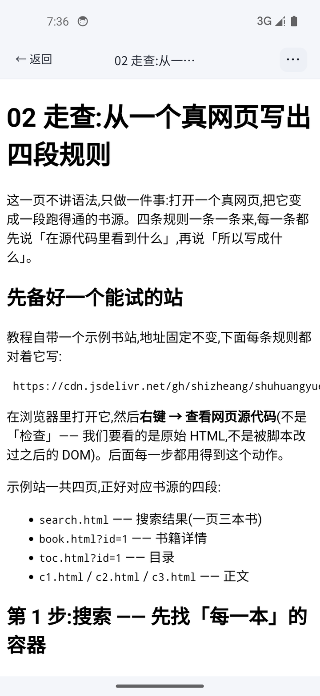

  <h1>书荒阅读</h1>
  
<b>你的书源 · 你的书架 · 你的设备</b>

  
安卓 + Windows 桌面 · 无广告 · 开源免费 · 数据不上传

书荒阅读是一款**本地优先**的网络小说阅读器:导入书源后,就能搜索、阅读、整本离线缓存;
也支持 RSS 订阅、本地电子书导入与听书朗读。书架、阅读进度、设置全部保存在你自己的设备上。

装好就能用:书架里已经有一本公版书,订阅里已经有一份**能照着写的书源教程** ——
不用先搞懂书源格式,也不用先去别的网站找规则。

## 下载

| 平台 | 下载 |
| --- | --- |
| 安卓(arm64 真机) | **[⬇ 下载 APK](https://github.com/shizheang/shuhuangyuedu/releases/latest/download/app-arm64-release-signed.apk)** |
| Windows(64 位) | **[⬇ 到 Releases 取最新安装包](https://github.com/shizheang/shuhuangyuedu/releases/latest)**(文件名形如 `abook_x.y.z_x64-setup.exe`) |

安卓装法:

1. 点上面的链接下载 `app-arm64-release-signed.apk`;
2. 点开它。系统第一次会拦一下,按提示允许「安装未知应用」即可;
3. 装完直接打开就能用。

> 装好后在「我的 → 关于 → 检查更新」里有应用内更新,会直接告诉你有没有新版本。

历史版本见 [Releases](https://github.com/shizheang/shuhuangyuedu/releases)。

## 三分钟上手

1. **先读一本书** —— 打开就是书架,里面有一本《红楼梦》,点开就能读。翻页、字号、主题、听书都在阅读页里。
2. **加更多书** —— 「发现」里导入书源,搜索书名;搜到的书一键加进书架。一本书在某个源里找不到时,可以一键换源重找。
3. **自己写书源** —— 「订阅」里有一份《书源与订阅源教程》,十页。**第一次写源从「02 走查」开始**:它对着教程自带的示例站,从「右键看网页源代码」讲到你写出搜索、详情、目录、正文四段规则,每一步都能当场跑通。

## 界面

  
  
  
  

书架 · 阅读 · 订阅 · 内置教程

  
  

我的 · 桌面端(窗口拉宽时左侧导航栏常驻,深色主题)

  

桌面端的订阅阅读页:左侧导航常驻,内容区与其它页面同宽

## 这个应用能做什么

**读**
- 主题、字号 / 行距 / 页边距 / 字体、翻页动画都能调;护眼、墨水屏、纸纹背景
- 目录、书签、阅读进度;长按选中与笔记批注
- 整本缓存与批量下载,断网也能看
- 听书:本机语音、在线朗读,也可以接你自己的网络朗读引擎

**管理**
- 书架自建分组与自动分组、批量导入、更新提醒、阅读统计
- 一键换源:这本书在别的源里找不到时,按作者 / 书名重新找,进度按比例对齐
- 本地导入:TXT / EPUB / HTML / Markdown / MOBI / AZW3;漫画 CBZ / ZIP / 图片型 PDF

**订阅**
- RSS 与 RSSHub,文章列表、内嵌视频播放
- 自带一份书源与订阅源教程,可持续更新

**数据**
- 全部存在本机;可导出 / 导入备份,也可以接你自己的 WebDAV 做云备份
- 不收集、不上传书架与阅读进度

更细的说明见[源码仓的 README](https://github.com/shizheang/shuhuang#readme)。

## 免责声明

1. 本应用是一款本地阅读工具,自身不提供、不存储、不传播任何书籍内容,也不内置任何书源。
2. 应用内的全部书籍内容均来自用户自行导入的第三方书源规则,由用户从公开网络获取。内容的合法性、准确性与完整性由内容提供方负责,与本应用无关。
3. 用户应确保自己导入和使用的书源规则符合当地法律法规,并尊重著作权人的合法权益。请勿使用本应用获取、传播盗版或侵权内容。
4. 本应用按"现状"提供,不对可用性、无中断或无错误作出任何明示或默示的担保。因使用本应用产生的任何直接或间接损失,开发者不承担责任。
5. 本应用为开源免费软件,不收取任何费用,也不对第三方书源的可用性、安全性或稳定性作任何承诺。
6. 若权利人认为某项内容侵犯其合法权益,请直接向该内容的提供方主张权利。

**请支持正版。**
